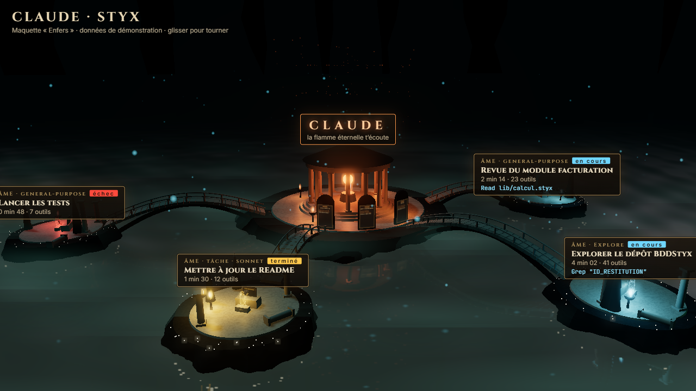
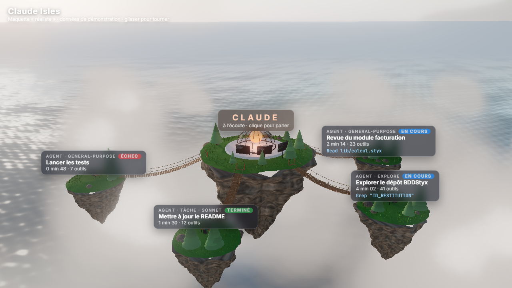
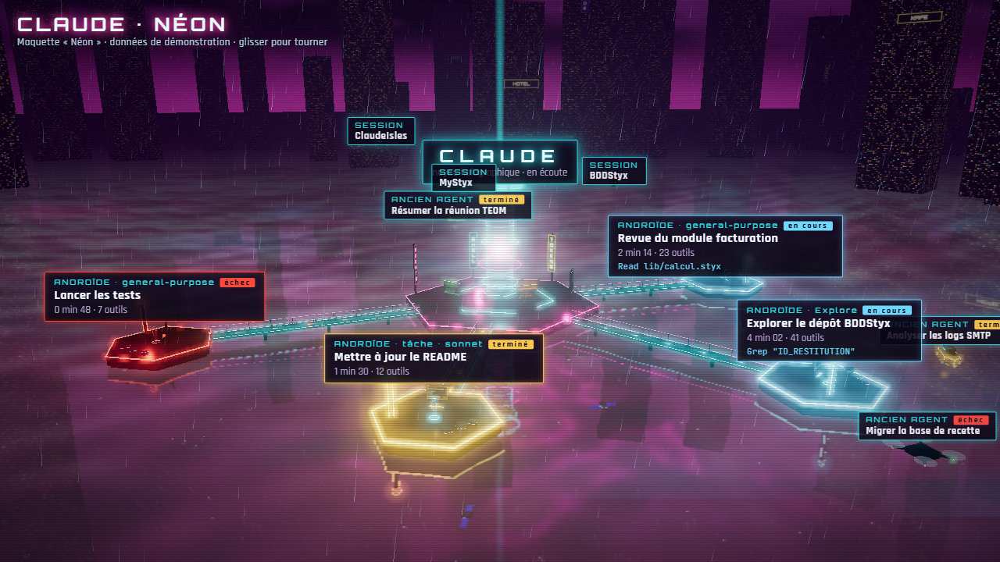
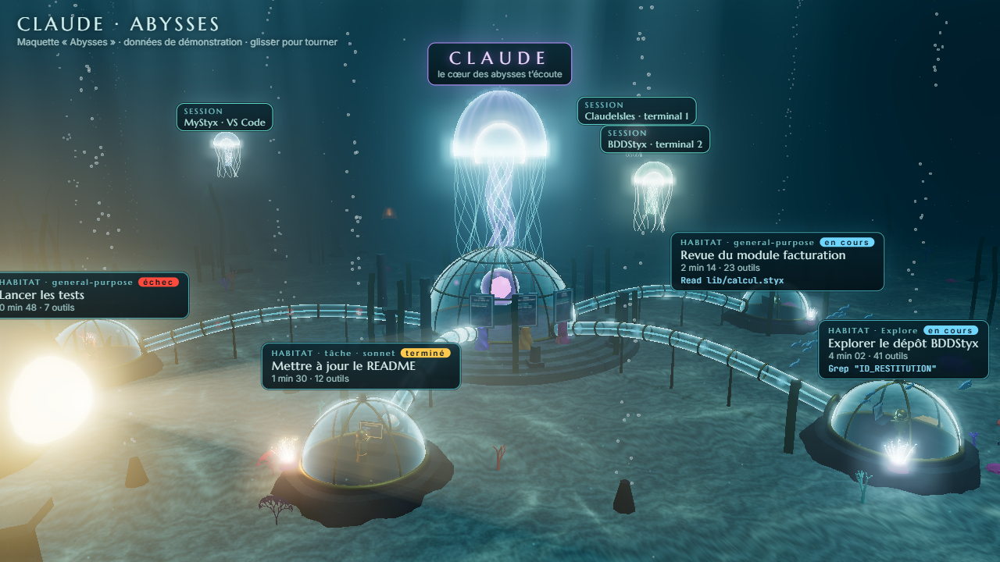
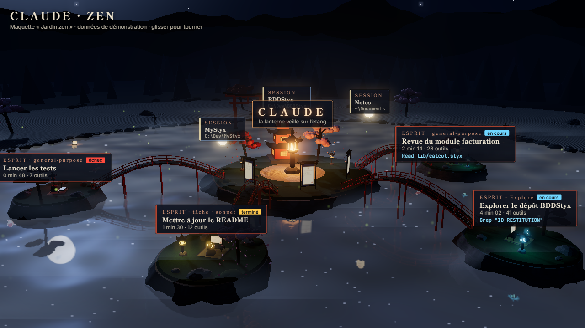

<h1 align="center">Claude Isles</h1>

Ce que fait Claude Code sur ta machine, en 3D, dans les Enfers grecs : une flamme éternelle, le fleuve Styx, et un îlot pour chaque agent.

  
  
  
  
  

Fait par William Loree.

Claude Isles lit en continu les journaux que Claude Code écrit déjà sur le disque et les met en scène. Aucun hook, aucun compte, aucune modification de la config de Claude : on lance le serveur, on ouvre le navigateur, et chaque appel d'outil, chaque agent, chaque shell en arrière-plan apparaît dans la caverne.

On peut aussi parler à Claude depuis la scène : un clic sur la flamme ouvre un terminal, et le formulaire de tâche lance un agent qui fait surgir son propre îlot.

## Lancer

| Mode | Commande | Adresse |
|---|---|---|
| Normal | `lancer.cmd` (installe, compile si besoin, ouvre le navigateur) | <http://localhost:4317> |
| Développement | `npm run dev` (serveur relancé à chaque modification + Vite) | <http://localhost:5181> |

Il faut Node.js et Claude Code (`claude`) installés et connectés.

## Ce que tu vois

| Dans la scène | Dans Claude Code |
|---|---|
| **La flamme éternelle**, sur l'autel du temple rond au centre | Claude lui-même. Elle grandit et le cœur s'agite quand il réfléchit. Clic (ou `T`) : terminal pour lui parler. |
| **Un îlot** relié au temple par un pont de marbre | Un agent (outil `Agent`) ou une tâche rapide. L'esprit de l'agent écrit à la plume sur une tablette où s'inscrit son activité réelle. |
| **Le brasero** de l'îlot | Le statut : bleu en cours, or terminé, rouge échec. |
| **Une barque** qui dérive sur le fleuve | Un ancien agent ou une ancienne tâche. Survol : son nom ; clic : son détail, la caméra suit la barque. |
| **Une stèle** gravée sur le parvis | Un shell en arrière-plan (`run_in_background`). La commande et la fin de sa sortie y luisent comme des braises, en direct. |
| **Une lanterne** au-dessus du temple | Une session Claude Code ouverte ailleurs (terminal, VS Code…). |
| **Charon**, au large, lanterne verte | Rien. Il fait sa ronde. |

Les 16 îlots sont prédéfinis (géométrie calculée une fois au chargement, graine fixe) : un agent prend simplement un emplacement libre, l'anneau intérieur d'abord. Pas d'agent, pas d'îlot.

## Maquettes

Le dossier `maquettes/` contient des scènes autonomes, avec des données de démonstration, qui s'ouvrent par double-clic sans rien installer. Elles servent à essayer d'autres univers avant de les porter dans l'appli.

| | | |
|---|---|---|
|    **Styx** · `styx.html`   Les Enfers grecs, base de l'appli. |    **Réaliste** · `realiste.html`   Îles flottantes au-dessus des nuages, ponts de cordes. |    **Néon** · `neon.html`   Une ville cyberpunk sous la pluie, Claude en noyau holographique. |
|    **Abysses** · `abysses.html`   Une cité engloutie, Claude en cœur bioluminescent. |    **Jardin zen** · `zen.html`   Un étang au clair de lune, ponts rouges et lanternes. | |

## Raccourcis

| Touche | Action |
|---|---|
| `T` ou `²` | Ouvrir / fermer le terminal |
| `N` | Nouvelle tâche rapide |
| `Échap` | Désélectionner |
| Terminal : `/tache <consigne>` | Lancer une tâche sans quitter le clavier |
| Terminal : `/new` | Repartir d'une conversation vierge |
| Terminal : `/cd <dossier>` | Changer le dossier de travail du hub |

## Comment ça marche

| Partie | Rôle |
|---|---|
| `server/watcher.mjs` | Lit en continu les journaux de Claude Code : `~/.claude/projects/<projet>/<session>.jsonl` (appels d'outils, notifications de fin), `…/<session>/subagents/agent-*.jsonl` (activité des agents) et `%TEMP%\claude\<projet>\<session>\tasks\<id>.output` (sortie des shells). |
| `server/runner.mjs` | Lance `claude -p --output-format stream-json` pour le chat du hub et les tâches. |
| `server/index.mjs` | Serveur local (127.0.0.1:4317) : flux SSE `/api/events`, API du hub et des tâches, sert `dist/`. |
| `src/scene/` | Scène three.js (React Three Fiber) : `Hub`, `Islet`, `Office` (esprit et tablette), `Ghost`, `River` (eau, barques, Charon, bougies), `Cave`, `Bridges`, `ShellStele`, `SessionSat` (lanternes), `materials` (textures procédurales, shader des fantômes). |
| `src/ui/` | Terminal, formulaire de tâche, liste, panneau de détail. |

- Le chat du hub reprend la même session d'un message à l'autre (`--resume`).
- Les sessions des dernières 24 h sont relues au démarrage. Un agent ou un shell terminé reste sur son îlot 45 min, puis l'agent part en barque (24 barques au plus). Sans signe de vie depuis 1 h 30, il est « perdu » (âme grise).
- `data/` (local, ignoré par git) garde la conversation du hub et les tâches des dernières 24 h.

## Sécurité

Le serveur n'écoute que sur `127.0.0.1` : rien n'est exposé sur le réseau. Les journaux de Claude Code sont seulement lus, jamais modifiés.

Le hub et les tâches tournent en mode **`acceptEdits`** : ils lisent et modifient des fichiers sans demander, mais les commandes shell que tes règles n'autorisent pas sont refusées. Donne-leur un dossier de travail que tu es prêt à voir changer.

## Limites connues

- Pensé et testé sous Windows (chemins `%TEMP%`, `lancer.cmd`).
- La scène n'affiche que ce qui passe par les journaux : un agent lancé sur une autre machine n'apparaît pas.
- 16 îlots au plus en même temps ; au-delà, les agents restent dans la liste (« +N sans îlot libre ») sans apparaître dans la scène.
